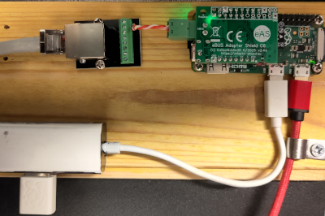
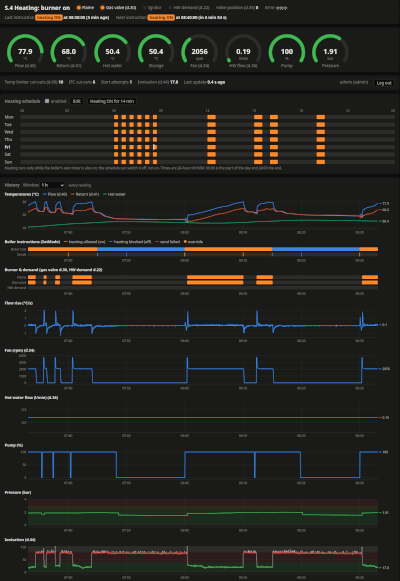

# Vaillant Boiler Controller UI

This repo contains a back end and web front end to control a Vaillant Boiler.

## Support

It has been tested on:

| Vaillant boiler model | Supported |
| --------------------- | --------- |
| ecoTEC plus 837       | ✅ |
| all others            | ❌ |

## ebusd Installation

Get it from https://github.com/john30/ebusd.

Install with:

```sh
./autogen.sh
sudo make install-strip
sudo systemctl daemon-reload
sudo systemctl start ebusd
sudo systemctl enable ebusd
```

## app installation from DEB package

Build the package (needs `dpkg-deb`; `make lint-deb` also needs `shellcheck`):

```sh
make deb VERSION=0.2.0
scp build/vaillant-boiler-ui_*_all.deb "$SERVER_USER@$SERVER_ADDR:"
```

Or push a tag such as `v0.2.0`: CI builds the package for that version and attaches it to a
GitHub release, so the Pi can fetch it directly:

```sh
wget https://github.com/zannen/vaillant-boiler-controller-ui/releases/download/v0.2.0/vaillant-boiler-ui_0.2.0_all.deb
```

On the Pi:

```sh
sudo apt install ./vaillant-boiler-ui_*_all.deb
```

On first install it creates a login `admin` (role admin) with a random password, prints the
password once, and starts the service. Change the password, or add more users, with:

```sh
sudo htpasswd -B -C 6 /etc/vaillant-boiler-ui/users.htpasswd admin
sudo nano /etc/vaillant-boiler-ui/roles     # roles for any new users
```

The printed password is also kept in apt's log, `/var/log/apt/term.log`, so change it after installing.

The package installs:

| Path | Contents |
| ---- | -------- |
| `/usr/bin/vaillant-boiler-ui.py` | the program (a link to `/usr/lib/vaillant-boiler-ui/vaillant-boiler-ui.py`) |
| `/usr/lib/vaillant-boiler-ui/vaillant_boiler_ui/` | the program's Python modules |
| `/usr/lib/vaillant-boiler-ui/static/` | the web UI's HTML, JS and CSS files, read at startup |
| `/usr/lib/systemd/system/vaillant-boiler-ui.service` | service, enabled on install; it waits until `users.htpasswd` has a user |
| `/etc/vaillant-boiler-ui/users.htpasswd`, `roles` | logins (root-owned, readable by the service only) |
| `/etc/default/vaillant-boiler-ui` | extra options in `BOILER_UI_OPTS` |
| `/var/lib/vaillant-boiler-ui/` | `boiler.db` (see [Data](#data)) and the token signing key |

It runs as the `boiler-ui` system user. `sudo apt purge vaillant-boiler-ui` deletes the logins and all logged data.

Now check out the server at `http://$SERVER_ADDR:8000/`.

## Heating schedule

Admins can set up to 10 on/off periods per day of the week on the web page; users and viewers can see it.
While the schedule is enabled, the app sends the boiler an eBUS `SetMode` message that blocks
central heating outside those periods, or allows it inside them. It sends on startup, when the schedule
is saved, at the exact minute of each on/off time, and on every 10-minute boundary of the clock
(xx:00, xx:10, ...), because the boiler ends the block about 15 minutes after the last message.
A failed send is retried after a minute.
Hot water is never blocked. Disabling the schedule allows heating once; then the boiler follows its own controls.

Users and admins also get a **Heating ON for 14 min** button. It sends one "heating on" at once, whatever
the schedule says, then nothing for 14 minutes (the boiler holds it for about 15); then the schedule's
state is sent and the 10-minute boundaries resume. Pressing it again restarts the 14 minutes.
Every instruction, with what triggered it, is logged in the database's `commands` table.

- Set the boiler's own timer to be on whenever you *might* want heating: the app can switch heating off, but not on.
- ebusd must allow writes: add `--accesslevel=*` to `EBUSD_OPTS` in `/etc/default/ebusd`.
- Each message also carries a heating flow and a hot water temperature, which admins set in the schedule
  editor (heating flow 30–85 °C, hot water 35–65 °C, in 0.5 °C steps). A change is sent to the boiler at once.
  They apply only while the schedule is enabled or an override is on; otherwise the boiler's own knobs apply.
  The boiler's d.71 setting (75 °C unless changed) still caps the heating flow. Until an admin saves them,
  75 and 52.5 °C are used; change those defaults with `--flow-temp` and `--hwc-temp` in `BOILER_UI_OPTS`.
- If the app or the Pi stops, the boiler returns to its own controls within about 15 minutes.

## Data

Everything the app logs, and the heating schedule, is kept in one SQLite database,
`/var/lib/vaillant-boiler-ui/boiler.db`:

| Table | Contents |
| ----- | -------- |
| `samples` | every reading: `ms` (Unix time in milliseconds) and the raw ebusd value of each boiler value |
| `summaries` | mean, min and max of the chart values per 1-minute and 15-minute `tier` |
| `changes` | the change list |
| `commands` | every `SetMode` instruction sent to the boiler |
| `schedule`, `schedule_periods` | the heating schedule and temperatures |

It is written every 30 s (`--flush-seconds`), one transaction at a time, so a power cut loses at most the
last batch and never leaves a damaged file. To look at it, install `sqlite3` and work on a copy:

```sh
sudo sqlite3 /var/lib/vaillant-boiler-ui/boiler.db ".backup /tmp/boiler.db"
sqlite3 -csv -header /tmp/boiler.db \
  "SELECT datetime(ms / 1000, 'unixepoch', 'localtime') AS time, * FROM samples ORDER BY ms DESC LIMIT 100"
```

**Upgrading from a version that wrote CSV files:** the first start imports `boiler.csv`, its `.changes.log`,
`.1min.csv`, `.15min.csv` and `.commands.csv` files, and `schedule.json`, once. The small files are imported
before the app starts; `boiler.csv` is imported in the background while it runs, and the charts fill in
when it is done. It carries on after a restart. Follow it with `journalctl -u vaillant-boiler-ui`; when it
logs "the old CSV files can now be deleted", you can delete them.

**Schema changes** are in `app/vaillant_boiler_ui/migrations.py`, applied in order at startup. The
database's `PRAGMA user_version` counts those applied. Never edit a migration that is on `main`: add a new
one. Before applying new migrations to an existing database the app copies it to `boiler.db.before-vN`.
A boiler value added to `VALUES` needs no migration: its column is added at startup.

## Development

Lint the shell scripts, YAML, Python, JS, CSS and HTML as CI does:

```sh
pip install -r requirements-dev.txt   # black, flake8, mypy, pylint, pytest and yamllint, e.g. in a virtualenv
npm ci                                # ESLint, Stylelint and HTMLHint
make lint
make test                             # Python tests
```

`make format` reformats the Python code with black.

## Hardware

- Raspberry Pi Zero with USB hub (in the data port) and wifi dongle
- [eBUS Adapter Shield C6](https://adapter.ebusd.eu/v5-c6/index.en.html)

[](images/pizero.png)

## Screenshot

[](images/screenshot.png)
