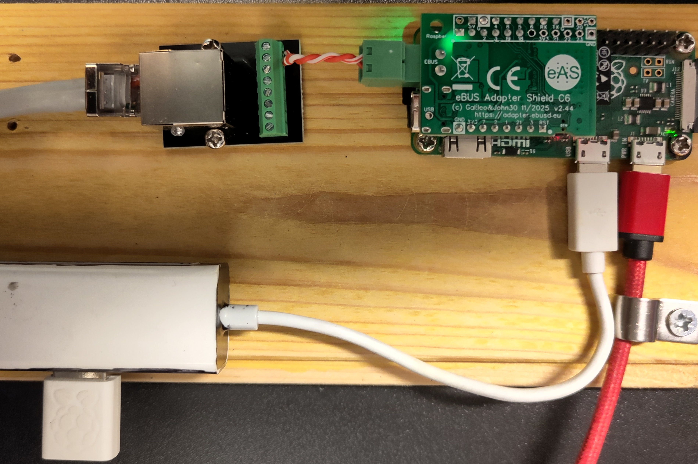

# Vaillant Boiler Controller UI

This repo contains a back end and web front end to control a Vaillant Boiler.

## Support

It has been tested on:

| Vaillant boiler model | Supported |
| --------------------- | --------- |
| ecoTEC plus 837       | ✅ |
| all others            | ❌ |

## ebusd Installation

Get it from https://github.com/john30/ebusd.

Install with:

```sh
./autogen.sh
sudo make install-strip
sudo systemctl daemon-reload
sudo systemctl start ebusd
sudo systemctl enable ebusd
```

## app installation from DEB package

Build the package (needs `dpkg-deb`; `make lint-deb` also needs `shellcheck`):

```sh
make deb                  # or: make deb VERSION=0.2.0
scp build/vaillant-boiler-ui_*_all.deb "$SERVER_USER@$SERVER_ADDR:"
```

On the Pi:

```sh
sudo apt install ./vaillant-boiler-ui_*_all.deb
```

On first install it creates a login `admin` (role admin) with a random password, prints the
password once, and starts the service. Change the password, or add more users, with:

```sh
sudo htpasswd -B -C 6 /etc/vaillant-boiler-ui/users.htpasswd admin
sudo nano /etc/vaillant-boiler-ui/roles     # roles for any new users
```

The printed password is also kept in apt's log, `/var/log/apt/term.log`, so change it after installing.

The package installs:

| Path | Contents |
| ---- | -------- |
| `/usr/bin/vaillant-boiler-ui` | the program |
| `/usr/lib/systemd/system/vaillant-boiler-ui.service` | service, enabled on install; it waits until `users.htpasswd` has a user |
| `/etc/vaillant-boiler-ui/users.htpasswd`, `roles` | logins (root-owned, readable by the service only) |
| `/etc/default/vaillant-boiler-ui` | extra options in `BOILER_UI_OPTS` |
| `/var/lib/vaillant-boiler-ui/` | CSV logs, summaries, change log, boiler instructions (`boiler.commands.csv`), heating schedule and token signing key |

It runs as the `boiler-ui` system user. `sudo apt purge vaillant-boiler-ui` deletes the logins and all logged data.

Now check out the server at `http://$SERVER_ADDR:8000/`.

## Heating schedule

Admins can set up to 10 on/off periods per day of the week on the web page; users and viewers can see it.
While the schedule is enabled, the app sends the boiler an eBUS `SetMode` message that blocks
central heating outside those periods, or allows it inside them. It sends on startup, when the schedule
is saved, at the exact minute of each on/off time, and on every 10-minute boundary of the clock
(xx:00, xx:10, ...), because the boiler ends the block about 15 minutes after the last message.
A failed send is retried after a minute.
Hot water is never blocked. Disabling the schedule allows heating once; then the boiler follows its own controls.

Users and admins also get a **Heating ON for 14 min** button. It sends one "heating on" at once, whatever
the schedule says, then nothing for 14 minutes (the boiler holds it for about 15); then the schedule's
state is sent and the 10-minute boundaries resume. Pressing it again restarts the 14 minutes.
Every instruction, with what triggered it, is logged to `boiler.commands.csv`.

- Set the boiler's own timer to be on whenever you *might* want heating: the app can switch heating off, but not on.
- ebusd must allow writes: add `--accesslevel=*` to `EBUSD_OPTS` in `/etc/default/ebusd`.
- The flow and hot water temperatures sent with each message default to 75 and 52.5 °C; change them with
  `--flow-temp` and `--hwc-temp` in `BOILER_UI_OPTS`.
- If the app or the Pi stops, the boiler returns to its own controls within about 15 minutes.

## Hardware

- Raspberry Pi Zero with USB hub (in the data port) and wifi dongle
- [eBUS Adapter Shield C6](https://adapter.ebusd.eu/v5-c6/index.en.html)


